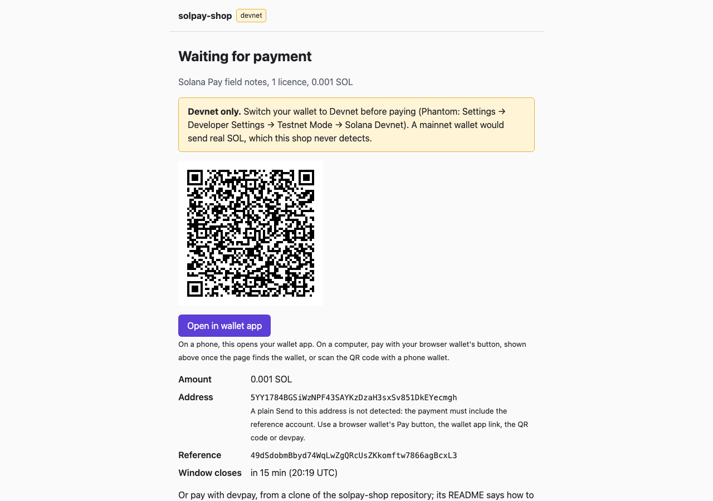
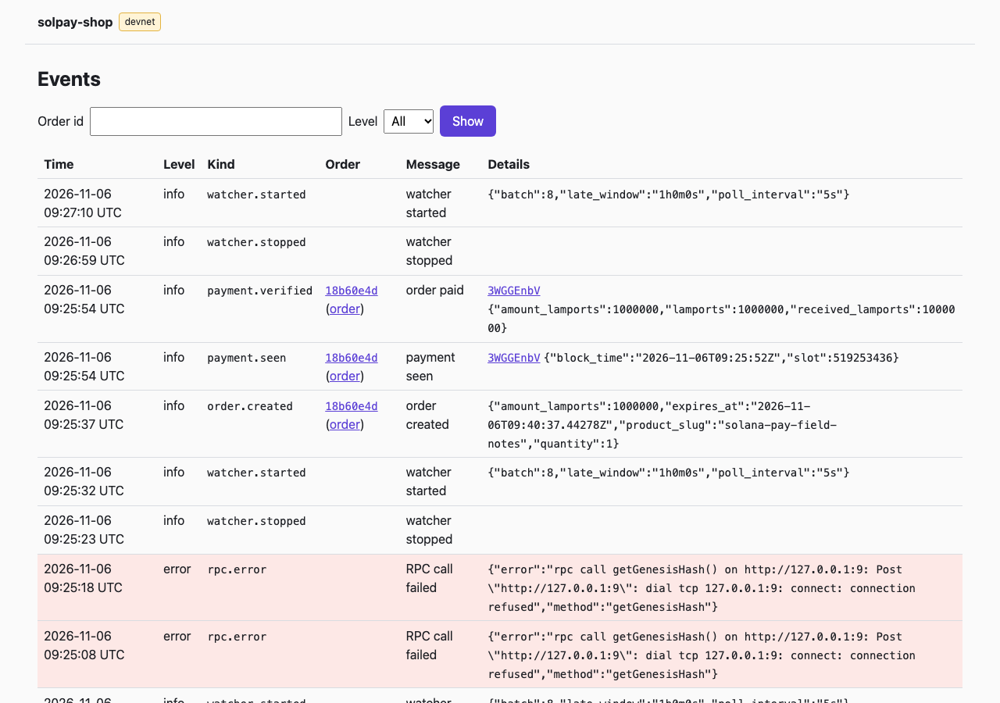

# solpay-shop

solpay-shop is a small Go service that sells digital downloads and accepts SOL on **Solana devnet**.
Devnet only: no real money is ever involved.

A portfolio project by Darius Aleksiūnas. It shows an explicit order state machine, an idempotent
payment ledger, a watcher that polls the chain for each order's payment, and signed download links.



## Quick start

You need Docker with Compose, `make` and `openssl` (most macOS and Linux systems have the last two)
and the address of a devnet wallet you control.

```sh
git clone https://github.com/aleksiuno/solpay-shop.git && cd solpay-shop
make env                         # creates .env with generated secrets
# edit .env: set MERCHANT_ADDRESS to the address of a devnet wallet you control
docker compose up --build -d     # or make up; the app is ready a few seconds later
curl localhost:8080/healthz      # prints ok
```

`make env` prints the ways to get a devnet address: Phantom in devnet mode, `solana-keygen pubkey`,
or devpay (below), which also runs with Docker alone. The shop needs the address, never the secret
key. Without `make`, copy `.env.example` to `.env` and follow its comments.

If compose stops at `migrate`, `docker compose logs migrate` names the setting to fix. `DB_PORT` and
`APP_PORT` in `.env` move the ports. `docker compose down -v` resets the database, which is also
needed after changing `POSTGRES_PASSWORD`. Secrets and the merchant address live only in `.env`,
which is never committed; the test fixtures and screenshots use throwaway devnet wallets.

Open <http://localhost:8080>, pick a product and check out. The order page reloads itself every 5
seconds while a payment sent on time is still expected, and shows the download link once paid. The
admin pages at <http://localhost:8080/admin/> list the orders, show each one's payments and events,
mark refunds, and add and edit products: sign in as `admin` with the `ADMIN_PASS` from `.env`.

## Paying on devnet

The shop finds a payment by the order's reference alone, so a plain Send to the merchant address,
or `solana transfer`, is never detected: pay with the QR code, the "Open in wallet" link or devpay,
a small command in this repository. A Solana Pay URL names no cluster, so a wallet set to mainnet
would send real SOL, which the shop never detects. Get devnet SOL at <https://faucet.solana.com>,
which may ask for a GitHub sign-in; `solana airdrop` no longer works on devnet.

```sh
go run ./cmd/devpay -new-keypair data/payer.json   # prints the payer's address to fund
go run ./cmd/devpay -keypair data/payer.json '<pay URL from the order page>'
```

Each reload of the order page clears a text selection, so copy the pay URL from the "Open in
wallet" link: right-click it and choose Copy link. devpay checks that the RPC node is on devnet,
refuses a URL without a reference and never overwrites a key file; key files in `data/` are never
committed. With Go 1.27, `go install github.com/aleksiuno/solpay-shop/cmd/devpay@latest` installs
it as `devpay`. Without Go, put this in front of the same `go run` commands:
`docker run --rm -u "$(id -u):$(id -g)" -e HOME=/tmp -v "$PWD":/src -w /src golang:1.27.3-alpine3.24`

Phantom may also work, but only devpay has been tested: switch Phantom to devnet (Settings →
Developer Settings → Testnet Mode → Solana Devnet), then scan the QR code on the order page.

## API

```sh
curl -i localhost:8080/api/v1/orders -d '{"product_slug": "solana-pay-field-notes", "quantity": 1}'
curl localhost:8080/api/v1/orders/<ORDER_ID>
set -a; . ./.env; set +a   # loads ADMIN_USER and ADMIN_PASS
curl -u "$ADMIN_USER:$ADMIN_PASS" 'localhost:8080/api/v1/admin/events?order_id=<ORDER_ID>'
```

Every endpoint, with its errors and a walkthrough, is in [docs/API.md](docs/API.md).

## Event log

<http://localhost:8080/admin/events> lists what happened to each order and what the watcher saw,
newest first, with errors in red. It filters by order and level. Each event is also a JSON log line
with a `kind`. `make run` also writes the log to `data/app.log`; compose logs to stdout only.

```sh
jq -c 'select(.kind) | {time, level, kind, order_id, msg}' data/app.log
docker compose logs app --no-log-prefix | jq -c 'select(.kind) | {time, level, kind, order_id, msg}'
```



## How it works

- An explicit state machine allows nine moves between six statuses, from pending to refunded.
- Each order's reference is 32 fresh random bytes, not a keypair, so the shop holds no private keys.
- A watcher polls devnet for each pending order's reference, and for an underpaid or expired
  order's until an hour past its deadline. It adds up the transfers to the merchant that list the
  reference, checked against the balance change.
- The ledger is keyed by transaction signature, so a transaction is credited once, however often
  it is seen. Each status change commits with its events in one database transaction.
- A paid order downloads its file by an HMAC-signed link that works for 15 minutes.

More in [docs/DESIGN.md](docs/DESIGN.md). Where to look: `internal/order/state.go`,
`internal/payment/watcher.go`, `internal/db/payments.go`, `internal/payment/watcher_test.go`.

## Development

`make help` lists the targets. With Go 1.27, `make run` runs the server on the host against the
compose database (first `docker compose stop app`, as both use port 8080), and `make test` runs
the unit tests, which need no Docker. `make test-integration` adds the Postgres tests, which need a
running Docker daemon; unless `DOCKER_HOST` is set, the Makefile takes it from the current Docker
context (tested on OrbStack). `make lint` runs the linters, and `make check test-integration`
runs what CI runs, apart from the image build.

Licence: MIT, see [LICENSE](LICENSE).
